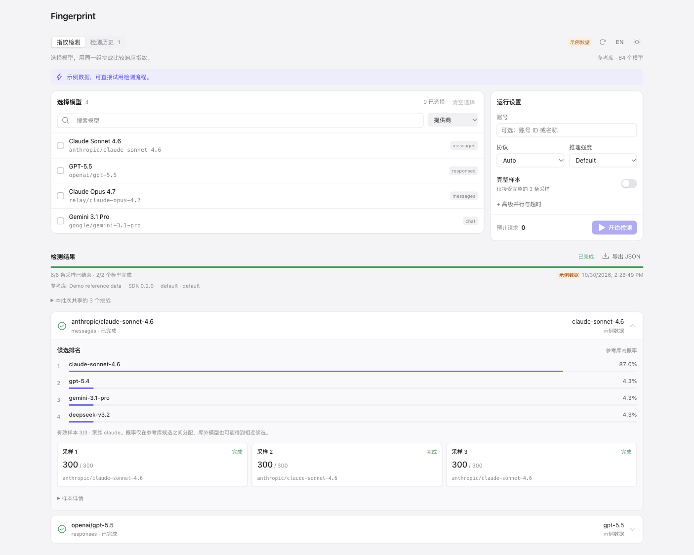

# Magpie Fingerprint

[简体中文](README.zh-CN.md) · [Magpie](https://github.com/yetone/magpie) · [lm-detector](https://github.com/Ikaleio/lm-detector)

Investigate suspected model substitution directly in Magpie. Compare numeric
response fingerprints across providers or repeat a run after a service changes.
The page reuses Magpie’s configured models and gateway; the pinned
`lmfpd-sdk` detector ranks nearby reference-bank models. Rankings are evidence
for investigation, not proof of model identity.



- Select up to 24 models across providers, with the same three challenges per batch.
- Reuse Magpie authentication and native endpoint metadata; optionally pin an account.
- Follow live sample counts, cancel work, and inspect the actual response route.
- Compare ranked candidates, including partial and unscorable outcomes.
- Keep raw replies and data versions in local history; export or copy JSON.
- Magpie's native page bridge, controls and design tokens; follows the host's theme and language.
- Compact model lists, keyboard-accessible view tabs, and narrow-screen layouts.

## Install

Install **Fingerprint** from **Plugins → Discover**, or use the CLI. Requires
a current Magpie release with `page.service` support and Bun 1.4.2+:

```sh
magpie plugin add @magpie-community/page-fingerprint
```

Open **Fingerprint** in the sidebar, or choose **Fingerprint** from a provider's menu.
Starting a detection sends three requests per selected model and uses that provider's quota.

## Development

Run these commands from `packages/fingerprint/`. Source, tests and the built
`dist/` assets are checked in. Installation and the offline tests do not need
package downloads: `vendor/lmfpd-sdk` pins the MIT SDK at 0.2.0. Only rebuilding
the UI and running the type checker require the development dependencies.
Direct build-tool versions are exact in `package.json`; `bun.lock` fixes the
complete dependency graph using `registry.npmjs.org`. Builds use Bun 1.4.4.
There are no install/pack lifecycle scripts. After a source change, rebuild
and commit the resulting `dist/` files.

The standalone project and release history are at
[KaranocaVe/magpie-fingerprint](https://github.com/KaranocaVe/magpie-fingerprint).

```sh
bun run rebuild
bun start
```

`rebuild` installs with `--frozen-lockfile --ignore-scripts` in an isolated
copy, runs typecheck/tests/build, and copies `dist/` back. This avoids Bun
resolving the parent monorepo's workspaces; its temporary directory is removed
on completion. In a standalone copy of this package, `bun install
--frozen-lockfile --registry https://registry.npmjs.org` and `bun run check`
produce the same build.

The plugin page service listens on `3488` by default and uses Magpie's gateway
at `http://127.0.0.1:3425`. Opening or refreshing the page never downloads
reference data. **Download reference data** explicitly fetches a fresh snapshot;
starting a run downloads one only when no usable snapshot is cached. There is
no background refresh. The default primary source is
`https://lm.ikale.io/data/`; its fallback is
`https://cdn.jsdmirror.com/npm/lmfpd-data@latest/`. These hosts see the client's
IP address. Reference downloads carry no provider credentials, model ids,
prompts or replies. Only an explicitly started job sends sampling prompts
through the configured gateway. See [integration.md](integration.md) for gateway
authentication, `magpie web`, environment variables, local reference sources,
and the explicit `--demo` fixture.

## Scope and limits

The first release supports numeric fingerprinting. Each run retains its loaded
reference snapshot and records its `builtAt` value. The remote reference data
is not version-pinned or authenticated by a locally pinned hash; the fallback
uses `@latest`. Runs use three shared challenges per batch, bounded work, and
cancellation. It records proposed, observed, and failed evidence separately;
it does not prove provider identity, authenticate a model, or infer hidden
tokenizers. `--demo` runs an isolated illustrative workflow without model calls.

Magpie middleware and protocol adapters still apply. A changed actual provider/model
invalidates that target's aggregate score. Account pinning is optional; it does not
turn a routed channel into an upstream identity guarantee. Tokenizer probing is deferred.

MIT licensed. Third-party notices are in [THIRD_PARTY_NOTICES.md](THIRD_PARTY_NOTICES.md).
